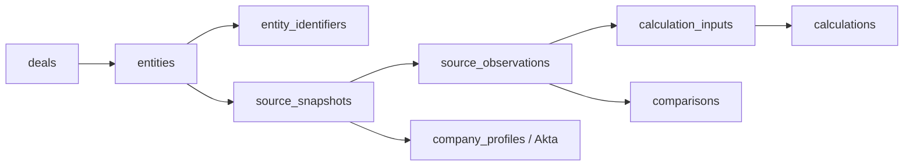

# Akta 公司主档与私有上传证据：DuckDB Schema

**Akta 是主要公司资料源；Orbis、PitchBook 等文件是模拟用户网页上传的补充证据。** `provider` 保存原始出处，`ingestion_channel` 和 `data_role` 表达产品中两条通道，避免把上传供应商报表误称为实时集成。

数据库是本地 DuckDB 文件，默认 `backend/.cache/acefire.duckdb`，可通过 `DUCKDB_PATH` 指定位置。表结构以 `backend/app/db_schema.py` 中的 `SCHEMA_SQL` 为准，`schema.sql` 由它生成原生 DuckDB DDL；`backend/app/store.py` 使用 DuckDB Python API，共享 Pydantic 合约位于 `backend/app/schemas.py`。运行 `python -m app.cli init-db` 创建数据库文件及表。

## 团队交接与 C 的职责

**B 读取 PDF、获取 Akta/其他补充资料并提取 Claim；C 维护数据库、规范化、财务计算和完整结构化公司报告；前端展示报告与来源。** 现有 Akta 保存文件加载器和本地 Orbis/PitchBook 读取器是演示/契约适配器，不把实时取数、PDF 识别列为 C 的生产职责。

原文件先登记为来源快照；B 通过 `POST /deals/{id}/claims/batch` 提交 `{"claims": [...]}`，每条 `ExtractedClaim` 引用当前 Deal 已存在的来源。C 保存 B 的原值和 page/line/cell/JSON locator，并按明确倍率确定性规范化；未知的定义、期间、行号仍为空，不补造定位。

`GET /deals/{id}/report` 统一返回可用公司主档、指标、全部已保存计算、比较、覆盖、缺口及来源图。报告完整性体现在“已有事实与缺口都交付”，不表示所有指标都有已验证数值。

报告的 `data_period_coverage` 按实际来源列出月度、季度、年度及其他期间、重叠、缺口和未知日期，不强制固定年度窗口。`POST /deals/{id}/calculate/revenue-dynamic` 可按真实覆盖计算收入，也可接受成对的目标起止日；只使用已审核收入定义和可比输入，避免把重叠的年度/月度/季度金额重复加总。

明确请求全年而来源只覆盖部分期间时，计算最终 `value=NULL`；`parameters.coverage.observed_total` 单独标记为部分已观察期间总额，缺失区间保留，不年化或补造。计算后可比数字存在差异时，报告返回 `conflict_numbers: true`、冲突值、差额与来源；不覆盖原值，也不增加前端审批流程。尚未确定可比性的问题单独标记为需要核对。

## 身份与两条来源通道

Company 保存 `primary_provider=akta`，`primary_company_id` 在 Akta 法律名称、域名与 UUID 验证后才填入。`entity_identifiers` 另存 CIK、BvD、Orbis、PitchBook 等来源标识；同名品牌、子公司、SPV 不自动合并。

| 字段 | Akta 主档 | 上传补充证据 |
| --- | --- | --- |
| `provider` | `akta` | `orbis` / `pitchbook` / `uploaded` |
| `ingestion_channel` | `provider_api` | `user_upload` |
| `data_role` | `primary_company_data` | `supplemental_evidence` |
| `visibility` | `deal_private` | `deal_private` |
| `original_filename` | 已保存响应的文件名 | 用户文件名 |
| `uploaded_at` | 离线 API 响应通常为空 | 上传取得时点 |

本版是单用户 localhost 原型；`deal_private` 是数据分类，不能代替尚未实现的生产鉴权或租户隔离。上传文件不能覆盖 Akta 公司主档。

## 核心关系



| 表 | 用途 |
| --- | --- |
| `deals`、`entities` | 项目、法律实体、主资料源及历史截止日。 |
| `entity_identifiers` | 经核对的跨来源公司标识。 |
| `source_snapshots` | 文件/API 响应版本、通道、用途、hash、取得时间和上下文。 |
| `source_observations` | 来源原值、规范化值、单位、期间、口径、scenario、locator、隔离状态。 |
| `company_profiles` | 按来源快照分别保存 Akta JSON profile，不用财务 section 覆盖完整主档。 |
| `calculations`、`calculation_inputs` | 白名单函数、版本、参数、输入 observation、公式与结果或缺失原因。 |
| `comparisons` | 两条 observation 的可比性、明确容差、差额及原因；不可比时无差额。 |
| `schema_versions` | 新库 Schema 基线版本。 |

金额原值、规范化值和计算结果使用精确十进制字符串，保存在 JSON payload 和 DuckDB `VARCHAR` 字段；Python `Decimal` 执行财务运算，不先转换为浮点数。不同来源、内容 hash 和版本独立留存；相同快照稳定 ID 支持重复导入不新增。

`locator` 使用带 `kind` 的 JSON 定位合约。例如 Orbis 保存 sheet/cell 和期间表头；保存的 Akta envelope 使用：

```json
{"kind":"json_pointer","pointer":"/response/data/financial_estimate/valuation_estimate"}
```

`kind` 表达定位类型，本身不等于任意输入已通过原件核验。B 提供的 PDF 页码、文本行号或单元格定位按原来源保存；原文件没有行号时不编造。Lineage 从主档或 observation 回到快照、原文件和字段位置；财务计算再关联具体输入。

UI 所需的文件来源图由 `/calculations/{id}/lineage` 返回：文件名、hash、预览链接、原值/规范化值、sheet/cell 或 JSON pointer、输入顺序、公式与结果，同时提供 `nodes` / `edges`。`calculation_inputs` 保存具体数字的依赖关系，不用一段 AI 解释代替来源链。

## 当前接入与已保存事实

当前公司适配器仅支持 **Circle**（`circle-2025-ipo`）。

1. **Akta 主资料**优先读取 `data/akta/` 的两份真实保存响应。Envelope 包含 `provider`、`fetched_at`、`request_parameters`、`response.data`。验证 Circle Internet Group, Inc.、`circle.com` 和 UUID `000004j` 后，将财务响应关联到同一主档实体。每份文件单独保存原始字节 hash 和 profile 绑定；`akta://` URI 表达逻辑来源，不冒充已观察的 HTTP 请求 URL。
2. 主资料响应包含 firmographic、location、product_offering、industry。财务响应只有 **valuation_estimate / `$25B+`**，没有收入估计。该区间保留为 unresolved 的来源观察，`value=NULL`；不从叙述中的效果数字生成已验证财务指标。
3. **Orbis/PitchBook 上传演示**来自 `data/additional-cases/circle-2025-ipo/`。Orbis 原生 Summary XLSX 可读取已知结构与单位；PitchBook 使用已有 observation JSON，并将 PNG 作为原生证据登记。二者均是 `user_upload + supplemental_evidence`，不是应用的实时供应商连接。
4. `POST /deals/{id}/files` 登记真实网页上传文件；已知 Orbis 工作簿可解析。通用 PDF、图片及其他未知表结构目前只登记快照，不宣称已完成 OCR、PDF Claim 提取或通用字段映射。

原件不改写。取得时间、供应商更新时间和财务期间分别存储；Circle 历史截止日为 **2025-05-27**，2026 年供应商视图及之后 FY2025/TTM 数据保留为后续补充，不回填为截止日已知事实。

## 比较与计算

接入时 `definition_key` 保持未确认。必须先审核指标定义、实体范围、会计基础、actual/forecast、期间与单位，才能做最终数字比较。Orbis 的 `Net Income before D&A` 不等于经营现金流；Sales 与 Operating revenue 不重复加总；PitchBook 的分析师调整口径与相邻 margin 不自动视为等价。

ARR 需要已确认 active MRR；Revenue 需要连续、完整、不重叠的收入期间；Burn 需要同一完整月份的经营现金流入/流出；Runway 需要同日非受限现金和正的月度净现金消耗。当前资料缺少必要的已审核输入时返回 `insufficient_data`，不能由估计区间、年度收入或净利润代替。

B/C 共用数据库与合约：B 提交提取结果和来源定位，C 核对引用归属并负责存储、规范化、计算与比较，再把完整报告交付前端。`GET /claims` 是 observation 查询别名；`POST /claims/batch` 是 B 的结构化交接入口，后端自身不因此具备 PDF 提取能力。前端及 LLM 绑定 C 返回的结构化字段。

## 运行状态与旧资料

当前演示使用真实保存的 Akta 响应，**不依赖实时连接**。此前 MCP/REST 和新密钥 REST 检查受到 Cloudflare 403 阻断；新密钥 MCP 检查因自动权限审查超时未执行，不能判定密钥无效或声称已测试成功。没有继续实时重试或绕过拒绝。

`database-design/evidence/`、`demo_checks.py`、`demo_results.json`、`data_inventory.json` 与旧 verification 文件是 Enfuce 留存检查，不是当前公司主档、上传数据或迁移的事实来源。启动、上传和 API 见 `backend/README.md`。

Akta 官方契约：[MCP 工具](https://docs.akta.pro/docs/developer-tools/mcp/tools)、[公司搜索](https://docs.akta.pro/docs/supporting-apis/company-search)、[JSON 公司资料](https://docs.akta.pro/docs/company-data/quick-start)。
