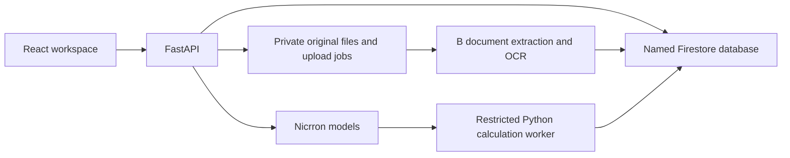

# Architecture

Ingenium keeps source evidence, computed results and generated prose distinct. The frontend renders backend results; it does not recompute financial values or invent source references.

## Runtime components

| Component | Entry points and ownership |
| --- | --- |
| Web application | `frontend/src/`; project routing, report review, evidence inspection and two chat drawers |
| API | `backend/app/main.py`; shared company, report, evidence and calculation contracts |
| Workspace intake | `backend/app/workspace_routes.py` and `workspace_intake.py`; durable file registration and extraction jobs |
| Document extraction | `backend/evidence/` and `backend/integrations/`; original bytes, native locators, OCR and model extraction |
| Shared storage | `backend/app/firebase_store.py`; immutable envelopes in the existing named Firestore database |
| Offline handoff | `backend/app/store.py` and `db_schema.py`; DuckDB import and local compatibility |
| Calculations | `backend/app/agent_calculation.py` and `agent_runtime.py`; generated code, restricted execution and audit records |
| Reports and chat | `backend/app/narrative.py`, `company_chat.py`, `stored_narratives.py` and B’s source-chat integration |

The home VM runs Nginx, the backend systemd service and the existing Cloudflare Tunnel. Nginx serves the compiled web application and forwards `/api/` to the loopback API. PRISM runtime configuration is preserved separately. The deployment layout and operational checks are in the [home server runbook](../deploy/home-vm/README.md).

## Evidence and calculation flow

1. Register a company and preserve the original uploaded bytes and SHA-256.
2. Extract claims with source locators: page/line, sheet/cell, CSV row or JSON pointer. Unknown locations and scales stay unknown.
3. Store the original observations, claims and snapshots. Akta background profiles retain their provider role; supplemental uploads do not silently replace them.
4. Select compatible inputs for a requested calculation. Retain currency, entity scope, definition, actual/forecast labels and exact period coverage.
5. Generate Python through the configured model, execute it locally and save the code, inputs, assumptions, logs, result and lineage. The worker is restricted local execution, not a hardware sandbox.
6. Render source-linked results and cited report prose. Human revisions remain distinct from automatic source-support checks.

Financial values use decimal strings. Missing values are not zero; partial months are not silently annualized; comparable numeric disagreements expose conflict flags. Supporting source sentences can be premises for analysis as well as citations for reports.

## Persistence boundaries

Firestore stores company records, source metadata, observations, claims, saved narrative reports and calculations. Records use `{schema_version, record_sha256, record}` envelopes. Original file bytes, extraction artifacts, durable job receipts and the private file index remain on the server outside its public web root.

The browser retains local project state, working drafts, revision history and browser-local files. Opening a different hostname creates a separate browser storage origin. The shared database does not automatically synchronize browser-local drafts or copy IndexedDB files between devices.

The two chat modes preserve different retrieval contracts: company chat receives the stored company report and requested context; source-file chat searches registered original files and source-located records. Both return validated source references and preserve explicit provider or citation failures.

See [Firebase integration](../backend/FIREBASE_INTEGRATION.md), [upload contracts](../backend/WORKSPACE_UPLOADS.md) and [narrative handoff](../backend/NARRATIVE_HANDOFF.md) for the detailed formats.
